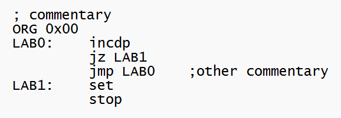

# Assembler for Packaged Enhanced Post's Machine 

## How it works
This repository contains the source code for the assembler program for the self-contained processing system, which features an SPI interface and is supported by an Enhanced Post’s Machine (EPM), whose hardware description is in the following repository:

https://github.com/galaguna/Packaged_Enhanced_Posts_Machine

The assembler program generates machine code from source code written in assembly language (a text file, typically with .asm extension) and saves it in text format in a file with .hex extension. The assembler program is written in Python and uses the PLY (Python Lex-Yacc) package as the basis and support for lexical-syntactic analysis.

## Formal Syntactic Grammar with EBNF Notation
The following is the formal specification of the production rules that govern the syntax of the assembly language for the microprocessor supported by an Enhanced Post’s Machine (EPM):

/* Main Program Structure */
<programa>        ::= <linea>*
<linea>           ::= [ <linea_asm> ] TERMINADOR
<linea_asm>       ::= <directiva_org> | <sentencia>
<sentencia>       ::= [ ETIQUETA ] <instruccion>

/* Origin Directive and Operands */
<directiva_org>   ::= "org" <numero>
<numero>          ::= DECIMAL | HEXADECIMAL
<destino_salto>   ::= ETIQUETA | <numero>

/* Instruction Categories */
<instruccion>     ::= <inst_noarg> | <inst_salto>

/* 1. Instructions Without Arguments */
<inst_noarg>      ::= "nop" | "incdp" | "decdp" | "set" | "clr" | "stop"

/* 2. Jump Instructions (Require an Address or Label) */
<inst_salto>      ::= ( "jmp" | "jz" ) <destino_salto>

## How to test
Using the assembler program is very simple; just run the EPM_assembler.py file in an environment that supports Python 3. Within the program, in the ‘main’ section, the ‘EPM_asm2hex()’ function is called, with the name of the source code file as its argument, as shown in Figure 2.4. For example, if you want to assemble the assembly code in the file Post_code.asm, you can leave this name as is or replace it with the name of the corresponding file. In either case, if the source code has no syntax errors, a file with .hex extension will be generated, containing the machine code that can be programmed into the microprocessor’s code space.
The following figure shows a simple example of assembly language code:

In this figure, you can see that the structure of an assembly program consists primarily of the following elements:
1.Comments, which always begin with the ‘;’ character.
2.The ORG directive (origin mnemonic), which specifies to the assembler the location where the machine code begins.
3.Labels, which are user-defined alphanumeric labels used to identify the locations where the machine codes (opcodes) of the subsequent instructions are stored.
4.The arguments, if any, of the instructions.

To load the executable program onto the processing system supported by a Post machine, use the programming system whose software and firmware are in the following repository:

https://github.com/galaguna/PostCPU_Programming_Tools

## How to cite
If you mention this project in a publication, I ask that you include the following citation for it
Laguna-Sanchez, G.A. (2026). Assembler for Packaged Enhanced Post's Machine.  
https://github.com/galaguna/PostCPU_Assembler

